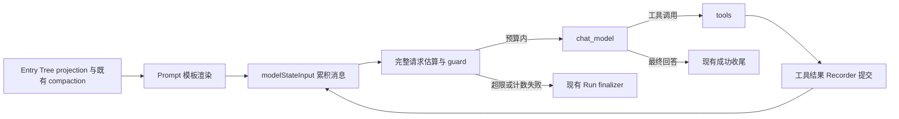

# Graph 模型调用预算防护：规范与实施审查稿

状态：用户已批准全部 Graph 预算防护实施，代码及文档已落地。review 的 3 项发现均已修复，修复后的全量测试与专项复核通过。验收记录见第 5、6 节；部署预算数值、真实端点兼容性和 Usage 校准仍由部署阶段确认。

## 1. 问题与目标

跨轮 Entry Tree projection 和持久化 compaction 已投产，但 Graph 工具循环会持续累积 assistant tool calls 和 tool results。首轮历史准备完成，不代表后续模型请求仍在预算内。

本变更已建立实际模型调用前的检查边界：每次检查当前完整文本输入、输出预留和安全余量；超限时不调用模型，通过现有 Run 终态流程结束并向用户说明原因。

运行时已确定为 Eino Graph，后续运行内压缩继续围绕 Graph 设计。ADK 调研保留为历史未采用方案，不是预算防护或后续缩减的前置条件；宏观设计已同步到 [上下文工程设计](context-engineering-design.md)。

本次交付完整输入估算、逐次检查、匹配的输出 cap 和受控拒绝，覆盖 server 聊天及摘要调用、live eval candidate。judge 使用独立配置和调用路径。工具结果缩减、artifact 读回及运行内摘要属于后续工作，尚未实施。

## 2. 历史发现与当前实现映射

### 2.1 实施前的静态发现

下表记录实施前的问题，不代表当前代码仍缺少这些能力。旧版本行号不作为当前实现定位依据。

| 位置 | 实施前行为 | 当前对应实现 |
| --- | --- | --- |
| `backend/internal/agent/interview/builder.go`，`modelStateInput` | 累积消息后直接返回，缺少逐次检查 | chat_model StatePreHandler 在累积后调用 guard，覆盖首次与工具循环 |
| `backend/internal/agent/interview/builder.go`，`bindTools` | 工具 Info 和绑定缺少共享计数快照 | schema 快照供 WithTools、工具节点与计数使用 |
| `backend/cmd/server/main.go` | 生产使用固定 128000 窗口和 4.0 字节/token 估算 | 经验证的显式预算、RequestTokenEstimator、共享 guard |
| `backend/internal/agent/context/compaction.go` | 旧准备策略使用 default 模型身份及分区额度，计数不完整 | server 使用真实配置身份及 PreparationBudget；实际调用另由 guard 检查，旧准备 helper 不作为最终保护 |
| `backend/internal/infrastructure/agent/openai/model.go` | 客户端未绑定输出预留对应的生成上限 | 根据显式模式只发送一个输出 cap |
| `backend/internal/agent/context/eino_summarizer.go` | 摘要 invoker 缺少最终 Prompt 检查 | server 使用 GuardedModelInvoker，检查实际摘要 messages |
| `backend/internal/application/chat/run_service.go`、`backend/internal/application/chat/generation.go` | 缺少预算分类及终态传播 | 应用层稳定错误、Run 收尾、snapshot/update/lease 传播 |
| `backend/internal/transport/httpchat/handler.go` | failed SSE 仅通用重试文案 | 根据安全分类固定映射错误文案 |
| `web/src/features/chat/types.ts`、`web/src/features/chat/components/ChatPane.tsx` | 历史错误转换与展示需补齐 | 实时 banner 与刷新历史的安全失败提示 |

依赖核对基于 Eino v0.9.19、eino-ext OpenAI v0.1.13、acl/openai v0.1.17 和 jsonschema v1.0.3。初稿仅做静态检查；当前已有实现与测试，不能继续沿用“未实施、未运行测试”的状态。

### 2.2 实现文件与验证入口

| 职责 | 实现文件 | 相关测试文件 |
| --- | --- | --- |
| 四显式配置与校验 | `backend/internal/infrastructure/config/budget.go`、`backend/internal/infrastructure/config/config.go`、`backend/.env.example` | `backend/internal/infrastructure/config/budget_test.go`、`backend/internal/infrastructure/config/config_test.go` |
| guard、分区与摘要包装 | `backend/internal/agent/context/model_budget.go` | `backend/internal/agent/context/model_budget_test.go` |
| 完整请求计数、schema 深复制与数字保真 | `backend/internal/agent/context/request_estimator.go` | `backend/internal/agent/context/request_estimator_test.go`、`backend/internal/agent/context/request_snapshot_numbers_test.go` |
| Graph 每轮检查与冻结工具 | `backend/internal/agent/interview/builder.go`、`backend/internal/agent/interview/frozen_tools.go` | `backend/internal/agent/interview/builder_budget_test.go`、`backend/internal/agent/interview/builder_budget_acceptance_test.go`、`backend/internal/agent/interview/builder_schema_failure_test.go`、`backend/internal/agent/interview/frozen_tools_test.go` |
| server 同源装配与摘要 guard | `backend/cmd/server/main.go` | `backend/cmd/server/main_test.go`、`backend/internal/agent/context/summary_budget_test.go` |
| provider 输出 cap | `backend/internal/infrastructure/agent/openai/model.go` | `backend/internal/infrastructure/agent/openai/output_limit_test.go` |
| 应用错误、Run 收尾与 generation 传播 | `backend/internal/application/chat/model_errors.go`、`backend/internal/application/chat/run_service.go`、`backend/internal/application/chat/generation.go`、`backend/internal/application/chat/generation_lease.go` | `backend/internal/application/chat/run_service_budget_test.go`、`backend/internal/application/chat/run_service_budget_tree_test.go`、`backend/internal/application/chat/generation_budget_test.go` |
| SSE 与历史提示 | `backend/internal/transport/httpchat/handler.go`、`web/src/features/chat/types.ts`、`web/src/features/chat/components/ChatPane.tsx` | `backend/internal/transport/httpchat/budget_test.go`、`backend/internal/transport/httpchat/budget_integration_test.go`、`web/src/features/chat/types.test.ts` |
| eval candidate guard | `backend/cmd/eval/main.go`、`backend/internal/eval/runner.go` | `backend/internal/eval/runner_test.go` |

projection 与 compaction 是既有生产能力：`backend/internal/infrastructure/repository/sqlite/context_projection_store.go`、`backend/internal/agent/context/manager_compaction.go`、`backend/internal/infrastructure/repository/sqlite/compaction_adapter.go` 将历史与摘要绑定到 Entry Tree。旧 `conversation_context_summaries` 表和 covered_sequence 兼容表示不是当前权威摘要边界；本变更不改 Entry Tree schema 或另建终态事务。

### 2.3 review 发现与修复状态

| 级别 | 发现 | 当前状态 | 剩余验证 |
| --- | --- | --- | --- |
| P1 | schema 转换或 custom estimator panic 未受控 | 已关闭：边界捕获后返回安全计数失败 | 非法 schema Build、计数 panic、安全正文测试及规范复核通过 |
| P2 | schema 快照深复制可能损失大数/任意 JSON 值精度 | 已关闭：空容器解码、UseNumber 递归恢复并校验完整序列化一致 | 大整数、嵌套 schema、双向隔离和全量测试通过 |
| P2 | frozen 工具对双接口的支持有问题 | 已关闭：保留全部八种可实现接口组合 | 参数/选项转发、错误透传和真实 ToolsNode 优先级测试通过 |

修复后的 `go test ./...`、`go vet ./...`、核心包 10 次随机顺序回归均已通过。

## 3. 规范

### B1：模型容量必须显式确定

生产聊天 MUST 使用明确的模型身份和上下文窗口。模型身份绑定已选择的客户端配置，不凭模型名称推断自定义 BaseURL 的容量。

- 不为任意模型静默采用 128000 或 DefaultBudgetConfig 的 32000 窗口。
- 窗口、输出上限和安全余量来自同一份经验证的配置快照。
- 窗口及输出上限为正数，安全余量非负，输出上限 + 安全余量 < 窗口；配置解析不吞掉非法值，安全余量为零也必须显式配置。
- 未配置模型时保留不启用聊天运行时的路径；模型已配置但预算缺失/非法时，不创建可调用聊天运行时，沿启动失败路径报告安全配置错误。
- 历史准备分区从窗口减去输出和余量后的输入容量按既有比例分配，舍入余数归历史。小窗口不套用固定 32000 分区，分区额度不替代实际请求检查。

配置名称与规则已确定，无默认生产预算数值；实际部署的窗口、输出上限、余量及端点模式兼容性仍须确认。

### B2：检查完整的模型输入

估算对象 MUST 是模型入口的消息和绑定工具定义，而非原始 HTTP 请求、数据库历史长度或预分配额度。

当前 `openai-text-json-bytes-v1` 覆盖：

- 完成模板渲染的 system、当前用户请求、访谈材料、摘要、保留历史。
- 消息 role、content、name、reasoning_content。
- assistant 的每个 tool call：index、ID、function 类型、函数名、完整 arguments 字符串。
- tool result 的内容及 tool_call_id 等配对字段。
- 绑定工具名称、描述及 ParamsOneOf.ToJSONSchema 的完整参数 schema；无参数工具保持当前适配器表示。
- 消息/工具 JSON 结构与转义产生的字节开销。

不序列化整个 schema.Message：Message.Extra 和工具本地元数据不作为发送字段计入。工具 schema 中的 JSON Schema 扩展属于参数定义，须保留并计数，不能与工具本地 Extra 混淆。

首版只支持文本聊天和文本工具结果。多模态、未知角色、nil 消息/工具、schema 转换或编码失败等返回明确的计数错误，不按零放行。P1 修复已为 schema/custom estimator panic 增加边界捕获，分类和安全正文回归通过。工具快照使用 UseNumber 保留任意 JSON 值及大数精度，不因深复制改变实际 schema。

### B3：每次调用独立检查

判定式：

```text
estimated_input_tokens + output_limit_tokens + safety_margin_tokens <= context_window_tokens
```

等于边界允许，超过边界拒绝。实现以减法计算可用输入容量，避免整数加法溢出。

- Graph 首次及每次工具循环回到 chat_model 均执行检查，在模型网络请求前阻断。
- 消息和工具定义与被检查请求一致，不在检查后注入额外未计数内容。
- 摘要 invoker 对最终摘要 Prompt 单独检查，不绑定或计入聊天工具 schema。
- 请求取消优先；估算后再次检查取消状态。
- 首版超限不自动重试、不截断任意消息、不另调摘要模型恢复。
- guard 无 Run 私有状态；每 Run 的累计消息与调用序号在 agentState 中维护，不能缓存首轮结果跳过后续检查。

### B4：估算精度与生成上限

复用 TokenEstimator 接口，生产与测试估算器可替换。当前生产实现为 `RequestTokenEstimator`，版本固定为 `openai-text-json-bytes-v1`。

CountText 返回 UTF-8 字节长度；CountMessages 将选定的消息/工具字段构造成 JSON 表示，通过 json.Marshal 编码后取字节长度，包含 JSON 字段、结构及转义开销，不再使用 len(text)/4 作为最终请求估算。

该表示不是整个 HTTP 请求的逐字节复刻，不包括全部 provider 封装或隐含协议开销；安全余量负责预留空间。它不是精确 tokenizer，也不能对任意模型数学保证永不超窗。中文、代码和大 JSON 可能较早被拒绝。生产精度、拒绝率、reasoning 开销和成本/质量影响仍需 Usage 对照或模型 tokenizer 校准。

模型请求生成上限 MUST 与输出预留相同。OutputLimitMode 只选择 `max_tokens` 或 `max_completion_tokens` 中的一项，不同时发送；对 reasoning 模型需确认端点将 reasoning 与可见输出如何计入该参数。

当前装配只支持已验证配置快照，不使用单次调用 option 或 ExtraFields 覆盖模型身份、窗口和输出 cap。未来 override 必须建立一致性检查，不能绕过 guard。

### B5：超限保持 Run 与 Entry Tree 的契约

预算失败复用 RunService finalizer 和 FinishAssistant 原子事务：

- 使用 `context_budget_exceeded`；计数失败使用独立 `context_counting_failed`，不混为普通 model_failed。
- 取消优先，其次 flush/recorder 持久化失败，再处理模型/预算错误。
- failed 不提交缓存 FinalMessage，FinalEntryID 为空。
- 已提交的工具事实保留；开放工具组按既有事务把 active head 移回 LastClosedEntryID，闭合组保留当前 head，遵循原有 CAS/version。
- 已接收且成功持久化的可见文本保留，不为错误提示清空。
- 终态事务失败不广播未提交终态。
- 摘要调用超限不追加候选 compaction、不推进边界；允许降级的路径仍须经过 Graph 最终 guard。

错误身份通过 Eino Graph/stream reader 包装后须由 errors.Is/As 识别。稳定契约在应用层 `model_errors.go`，agent 依赖该契约，应用层不反向导入 agent/context。Entry Tree/head 的开放、闭合及闭合后再开放组合由真实 SQLite 集成测试直接覆盖，同时验证 CAS/version、失败事实保留与终态分类。

### B6：反馈与观测

已实现的预算失败固定文案：

> 本次请求的上下文超过模型容量，生成已停止。请缩小请求范围，或使用上下文容量更大的模型。

计数失败固定文案：

> 本次请求的上下文无法安全计数，生成已停止。请检查模型和输入配置。

- 数据库存储稳定码和安全文案；generation hub、lease、snapshot、update、HTTP SSE 映射同一分类。
- 活跃订阅、终态重新订阅和刷新历史保持安全失败语义；普通模型失败仍使用既有通用提示。
- HTTP 和前端按固定映射展示，不透传 provider 诊断、Prompt、工具参数/结果或 panic 内容。
- guard 本地 debug 日志仅包含阶段 chat/summary、调用序号、计数器版本、输入估算、窗口、输出预留、余量、判定原因和耗时；未知阶段规范化为 unknown。
- 不新增外部 Trace 权限；未实现的压缩率、artifact 或 Usage 校准观测不作为现有交付。

## 4. 接入设计与已确定配置



### 4.1 共享配置与检查器

ModelCallGuard 与历史准备 BudgetPolicy 分工：前者决定实际请求可否发出，后者规划可选择历史的额度。server 的 `newChatExecutor` 从经验证的 OpenAIConfig 创建 ModelCallConfig、RequestTokenEstimator 和 guard，向 Graph、摘要 invoker、准备分区及客户端传递同源配置。

四项已确定配置如下，均无默认部署值：

| 配置 | 规则 | 部署要求 |
| --- | --- | --- |
| OPENAI_CONTEXT_WINDOW_TOKENS | 正整数；当前模型/端点的已确认窗口 | 显式填写真实容量，不推断 128000/32000 |
| OPENAI_MAX_OUTPUT_TOKENS | 正整数；同时用于输出预留与 provider cap | 显式填写，不自动采用旧分区的 4000 |
| OPENAI_CONTEXT_SAFETY_MARGIN_TOKENS | 显式非负整数，零合法；输出 + 余量 < 窗口 | 数值结合端点和校准确认，不设隐式默认 |
| OPENAI_OUTPUT_LIMIT_MODE | max_tokens 或 max_completion_tokens | 显式选择端点支持的模式，只发送该字段 |

测试使用显式配置和可替换计数器。配置解析错误只报告字段/规则，不回显原值。聊天 guard 是必需依赖，不能省略后回退成未经检查调用。

### 4.2 Graph 与工具快照

Builder 要求非 nil guard。chat_model 的 StatePreHandler 在 modelStateInput 累积消息后检查，再返回给模型；不新增 Graph 节点或第二套运行时。

一次 Build 读取 Info、转换并深复制 schema，WithTools、计数和 frozen 工具包装共享定义。快照恢复保留嵌套 schema 扩展与任意 JSON 值，UseNumber 避免大数先变为 float64。冻结包装保留原工具全部八种可实现接口组合，invoke/stream 分别转发，沿用 ToolsNode 的 enhanced 优先级；相关 review 修复与专项测试已完成。

工具结果先完成 Recorder 提交，再进入下一次模型输入检查；工具事实安全投影和提交顺序沿用既有契约。多个 Run 共享无会话状态的客户端与 guard，消息、序号仍隔离在各自 state。

### 4.3 摘要调用

server 通过 GuardedModelInvoker 包装基础客户端的 Generate。完成构造的摘要 messages 单独检查，不发送聊天工具 schema。聊天与摘要使用相同窗口及输出 cap；未来独立摘要预算必须同时同步 provider 上限，不能只在本地扣更小预留。

摘要和 compaction 已存在，不因本次 guard 就宣称完成分批摘要、运行内摘要或新压缩策略。候选摘要只有生成、校验和持久化成功才是已提交边界；既有 CAS conflict 下的本轮使用不等于落盘成功。

### 4.4 eval candidate 与独立 judge

`cmd/eval` 的 live 模式使用 config.Load/ValidateForChat 创建 candidate 和预算 guard，并传入 Runner/Graph Builder；validate 模式不因此发起模型调用。

judge 由 EVAL_JUDGE_API_KEY、EVAL_JUDGE_MODEL、EVAL_JUDGE_BASE_URL 独立创建，不继承 candidate 的窗口、余量、输出模式或 guard。通用 NewChatModel 在完全未提供预算字段时保留独立 judge 的兼容行为；提供任一预算字段则需通过完整校验。不能宣称所有评测模型调用都已受该 guard 保护。

## 5. 验收场景

保留 A1–A16 作为验收契约。自动化验证使用真实 Graph、真实 SQLite 收尾及本地假 HTTP server；生产 Usage 和实际端点参数另行确认。

| ID | 场景 | 必须验证 | 验收证据与状态 |
| --- | --- | --- | --- |
| A1 | 无模型配置、合法配置、缺窗口、非法输出/余量、总额度超窗 | 保持无聊天路径；非法预算不产生可调用运行时；错误不泄密 | config/budget 与 server 装配测试通过 |
| A2 | 中文、代码、大 JSON、嵌套 schema、多个 tool calls/results | 完整字段计数；schema/arguments/result 增长改变估算 | request_estimator 与 request_snapshot_numbers 测试通过，含扩展与大数隔离 |
| A3 | 模板、摘要、访谈材料分别增长 | 检查最终渲染结果，不能只计 history/query | builder_budget_acceptance 专项测试通过：精确基线允许，最终 Prompt 各部分增长被拒绝 |
| A4 | 等于边界、超过 1 单位、极大输入 | 边界允许，超限模型零调用，无溢出 | model_budget 边界与 max-int 测试通过 |
| A5 | 首轮允许、工具返回后第二轮超限 | 阻断下一次调用，闭合工具事实保留 | builder_budget 真实 Graph 测试通过 |
| A6 | 多个允许的工具轮次 | 逐轮检查，调用次数/序号正确 | builder_budget 多轮与跨 Run 测试通过 |
| A7 | schema/计数失败、nil、多模态、panic | 安全拒绝，无模型调用，分类正确 | estimator/guard 失败测试及 builder_schema_failure 测试通过 |
| A8 | Graph/stream 错误包装 | errors.Is 识别稳定预算分类 | builder_budget 的真实流式包装测试通过 |
| A9 | 预算失败与取消、flush/recorder 失败竞争 | 原终态优先级及有效提交不变 | run_service_budget 优先级测试通过；当前 CGO 环境不能运行 race |
| A10 | 部分文本、闭合/开放工具组 | 保留文本/事实，无 FinalEntryID，head/CAS/version 正确 | run_service_budget_tree 真实 SQLite 六组合测试通过，含闭合后再次开放 |
| A11 | 终态提交失败 | 不广播假终态 | run_service_budget 提交失败测试通过 |
| A12 | 实时、重连、刷新历史 | 固定安全文案，普通失败保持通用反馈 | generation、HTTP budget 及前端 9 项测试、TypeScript 检查通过 |
| A13 | 最终摘要 Prompt 超限 | 模型零调用，不推进 compaction | summary_budget 真实 Manager/摘要集成测试通过，包含允许时提交对照；错误向上传播，不新增恢复旁路 |
| A14 | provider 输出 cap | 唯一字段等于预留，两模式均验证 | output_limit 本地 HTTP Generate/Stream 测试通过；真实端点兼容性留作部署确认 |
| A15 | 并发 Run、动态 Info、空工具集 | 无跨 Run 污染，绑定/计数快照一致 | builder_budget_acceptance 的 8 个并发 Run、每 Run 六轮工具调用通过；动态 Info、空工具集和 frozen_tools 接口组合测试通过 |
| A16 | 日志与错误正文 | 无 Prompt、结果、参数、API key 泄露 | guard 安全日志、schema panic、Run/HTTP/history 固定映射测试通过 |

生产 token 精度和拒绝率需后续 Usage 对照；本地测试不能证明任意生产模型的实际容量。

## 6. 四切片实施与验收状态

本次实施已获批准。代码与规范验收项已完成，生产参数确认和质量校准作为部署工作单独记录。

### 切片 1：配置、完整计数与调用检查器

- [x] 四项显式配置及完整校验，无默认生产预算数值。
- [x] 唯一输出 cap 与预留一致，eval candidate/judge 边界明确。
- [x] 完整文本请求估算与 ModelCallGuard，整数边界及取消检查。
- [x] schema/custom estimator panic 安全拒绝，UseNumber 大数及深复制隔离修复。
- [x] A1、A2、A4、A7、A14、A16 自动化验证通过。

### 切片 2：Graph 与摘要接入

- [x] 每次 modelStateInput 检查实际累积输入，工具绑定/执行/计数共享快照。
- [x] 冻结包装保留全部原执行接口，ToolsNode 行为测试通过。
- [x] server 同源装配、合法准备分区及最终摘要 guard，移除固定通用窗口。
- [x] live candidate 接入，judge 独立；摘要拒绝不推进 compaction。
- [x] A3、A5、A6、A8、A13、A15 组合验证通过。

### 切片 3：受控收尾与用户反馈

- [x] 稳定应用错误分类，取消和持久化失败优先级保持。
- [x] hub/lease/snapshot/update、HTTP SSE、刷新历史固定安全反馈。
- [x] A9–A12 回归与真实 SQLite 工具组/head/CAS 验证。

### 切片 4：整体 review 与规范同步

- [x] 规范与代码标准并行 review；三项发现修复并专项复核。
- [x] 修复后 backend `go test ./...`、`go vet ./...` 通过。
- [x] context/interview/chat/httpchat 核心包 10 次随机顺序回归通过。
- [x] 前端 `npx tsc -b` 及 9 项 Node 测试通过，未启动前端服务。
- [x] OpenSpec CLI 1.14.1 与 `graph-model-budget-guard --strict` 校验通过；任务状态与两份设计稿同步。
- [x] 记录竞态检测限制：`go: -race requires cgo; enable cgo by setting CGO_ENABLED=1`，当前环境 CGO_ENABLED=0，未声称 race 通过。

变更保留在工作区供 review，未提交或自动归档。运行内缩减、artifact 与运行内摘要属于后续范围。

## 7. 已批准决策与部署待确认项

| 决策 | 已确定内容 | 剩余事项 |
| --- | --- | --- |
| 首版范围 | 完整计数、每次检查、受控拒绝，覆盖 server 聊天/摘要和 live candidate | 运行内缩减、artifact、运行内摘要另行实施 |
| 运行时 | Graph-only；ADK 历史调研未采用 | 后续压缩继续接入 Graph 边界 |
| 模型容量 | 四显式配置，不推断通用窗口 | 实际部署窗口、输出与余量数值待确认 |
| 输出参数 | 显式选择 max_tokens 或 max_completion_tokens，只发一项 | 实际端点和 reasoning 计入规则待确认 |
| 计数实现 | openai-text-json-bytes-v1，接口可替换；非精确 tokenizer | Usage 校准、生产拒绝率和 tokenizer 适配待完成 |
| 安全反馈 | 稳定分类与固定文案，保留已持久化部分文本 | 实时、重连与刷新历史的测试通过 |
| review 修复 | recovery、UseNumber 与完整接口冻结已完成 | 三项发现已关闭，修复后全量与专项复验通过 |

批准实施的决定已生效，不再要求重复批准。部署参数确认、质量校准与 review 修复关闭分别记录，不能用任一项的完成代替其余验收。
